# PFO Meta-analysis v5 (Luna)

**Analysis status:** Rebuilt in an isolated v5 package; v4 was not overwritten.

**Design:** Publication-style grouped forest plots modeled on the supplied blue-gray reference figure. Export formats: PNG, PDF; PNGs are linked below and embedded in the HTML report.

## Methods

Comparative models use risk ratios for binary efficacy/safety outcomes and mean differences for MIDAS, with REML random effects and Hartung-Knapp confidence intervals. Rare-event primary models use Mantel-Haenszel risk differences without a universal continuity correction. Supportive single-arm analyses use a logit-normal REML model and are not comparative treatment effects.

Rows are selected through `data_derived/luna_manifest.csv`. Narrative-only rows, the countless Zhang duplicate, and Darsaklis narrative rare-event rows are excluded from quantitative models. Derived and conditional rows are labeled and isolated in the manifest.

## Results

| Model | Measure | k | N | Estimate | CI low | CI high |
|---|---:|---:|---:|---:|---:|---:|
| ecl6_core | RR | 3 | 415 | 1.01 | 0.94 | 1.08 |
| ecl12_gen_core | RR | 2 | 181 | 1.10 | 0.40 | 2.97 |
| ecl12_mig | RR | 2 | 228 | 1.03 | 0.59 | 1.78 |
| ecl24 | RR | 2 | 240 | 1.02 | 0.67 | 1.55 |
| strict_early | RR | 3 | 235 | 1.10 | 0.85 | 1.43 |
| cve_late_core | RR | 3 | 238 | 2.14 | 1.34 | 3.40 |
| cve_late_with_luani | RR | 4 | 573 | 1.27 | 0.24 | 6.62 |
| midas_12m | MD | 2 | 272 | -0.76 | -2.03 | 0.50 |
| af_late_core | RR | 2 | 290 | 1.03 | 0.00 | 1243.36 |
| af_late_with_luani | RR | 3 | 625 | 1.77 | 0.24 | 12.93 |
| drt_any | RD | 4 | 573 | 0.01 | -0.00 | 0.03 |
| embolization | RD | 4 | 573 | 0.00 | -0.00 | 0.01 |
| pericardial | RD | 3 | 435 | -0.01 | -0.02 | 0.00 |
| sa_proc_success | proportion | 4 | 221 | 0.98 | 0.93 | 1.00 |
| sa_closure_12m | proportion | 3 | 197 | 0.93 | 0.41 | 1.00 |
| sa_drt | proportion | 2 | 181 | 0.04 | 0.00 | 0.99 |
| close12_mig_strict | RR | 2 | 228 | 0.97 | 0.39 | 2.42 |
| shunt_g6_general | RR | 2 | 191 | 0.79 | 0.09 | 6.82 |
| af_late_full | RR | 3 | 480 | 1.02 | 0.21 | 4.99 |
| af_late_full_with_luani | RR | 4 | 815 | 1.70 | 0.52 | 5.60 |
| af_any_6m | RR | 2 | 249 | 1.28 | 0.00 | 41280.55 |
| af_any_late | RR | 4 | 539 | 0.84 | 0.31 | 2.23 |
| af_any_late_with_darsaklis | RR | 5 | 706 | 0.94 | 0.46 | 1.93 |
| ecl6_expanded_early | RR | 3 | 235 | 1.13 | 0.90 | 1.42 |
| ecl12_gen_with_luani | RR | 3 | 452 | 1.04 | 0.94 | 1.15 |
| bleeding | RD | 4 | 430 | 0.02 | -0.02 | 0.05 |

## Figures

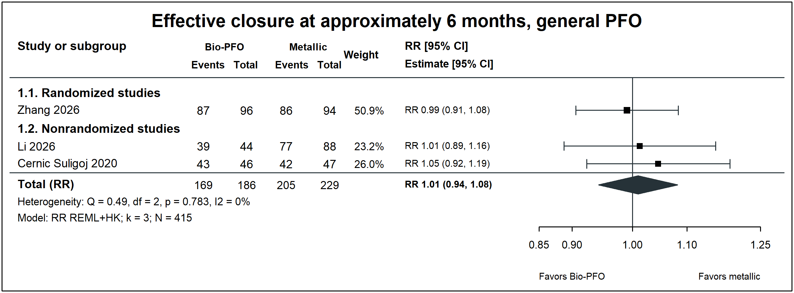
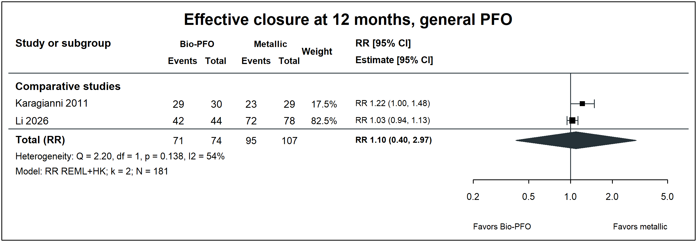
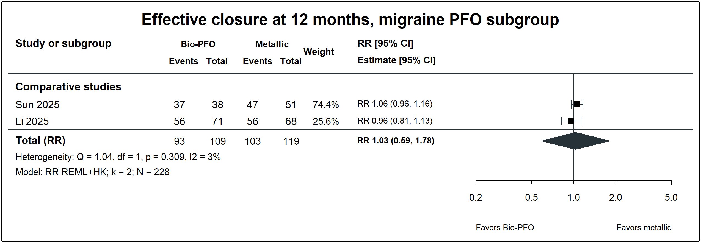
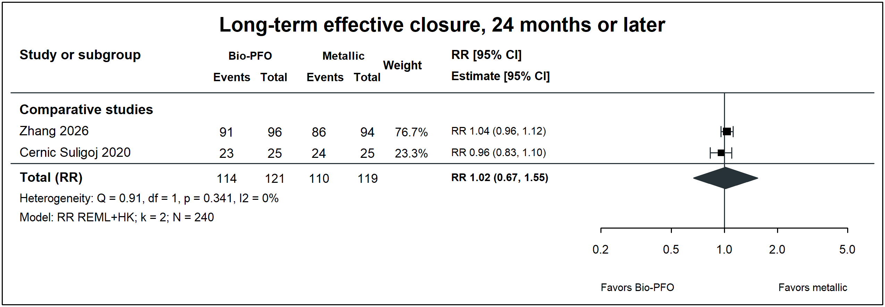
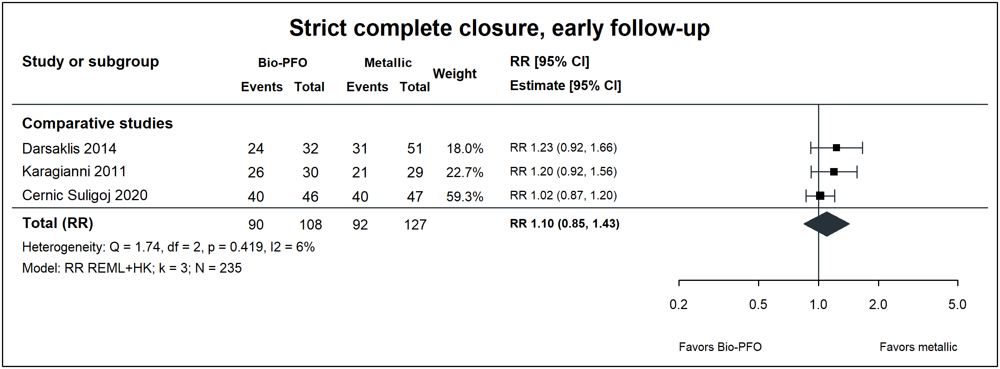
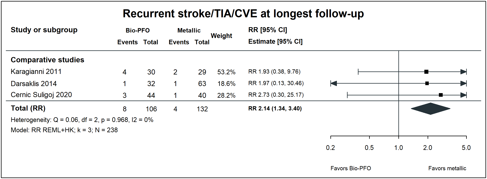
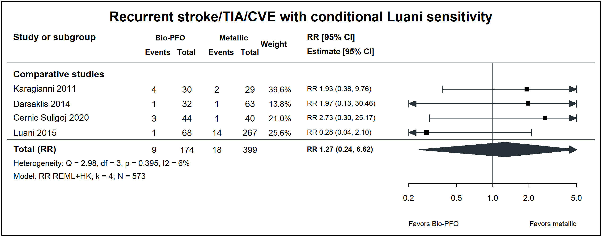
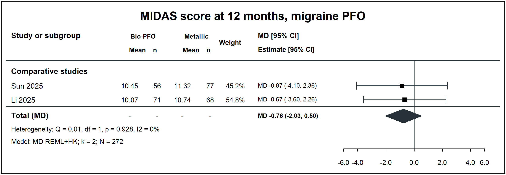

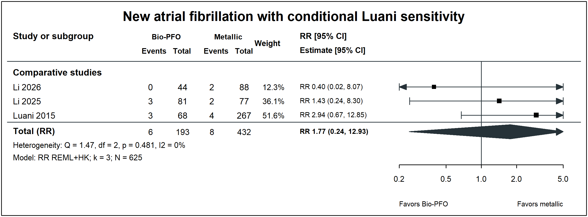
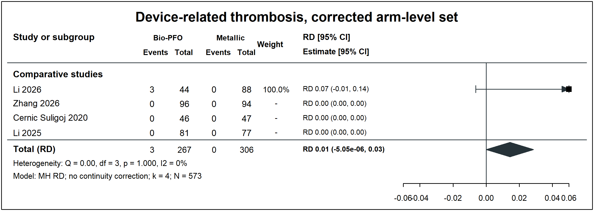
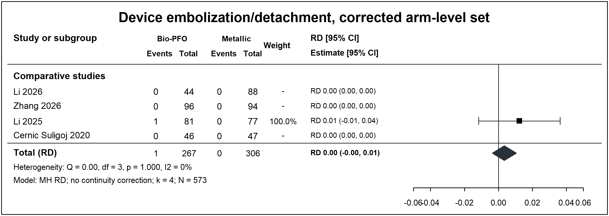
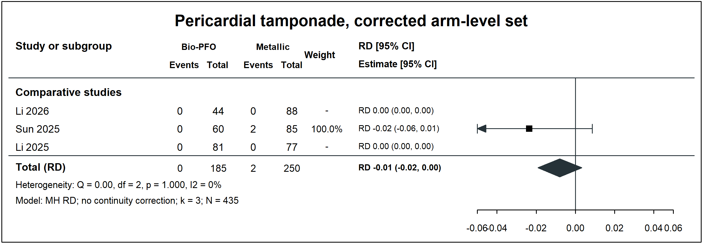
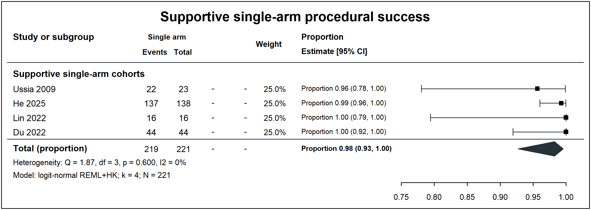
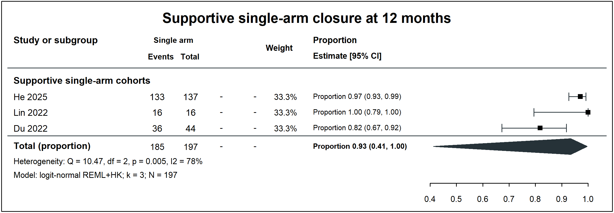
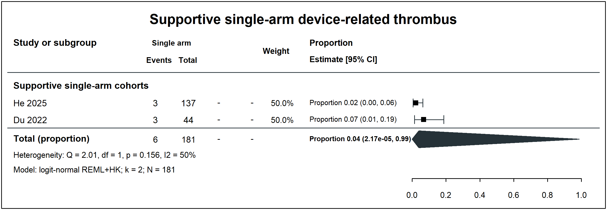
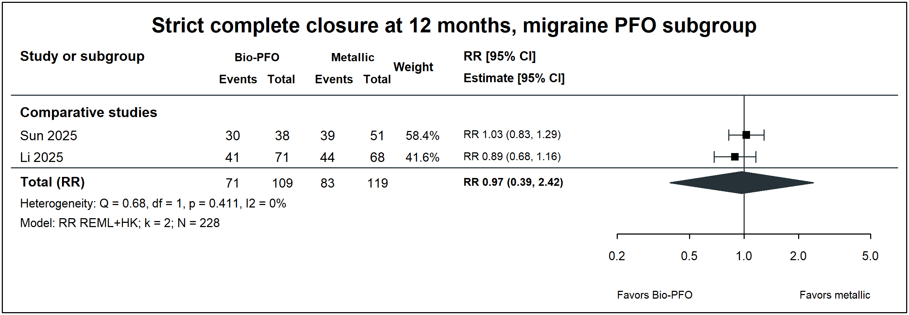
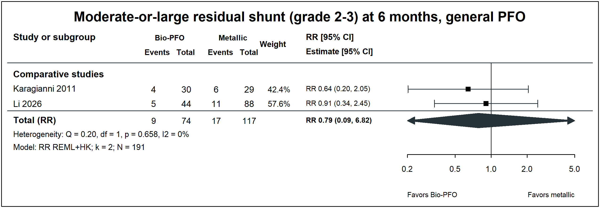
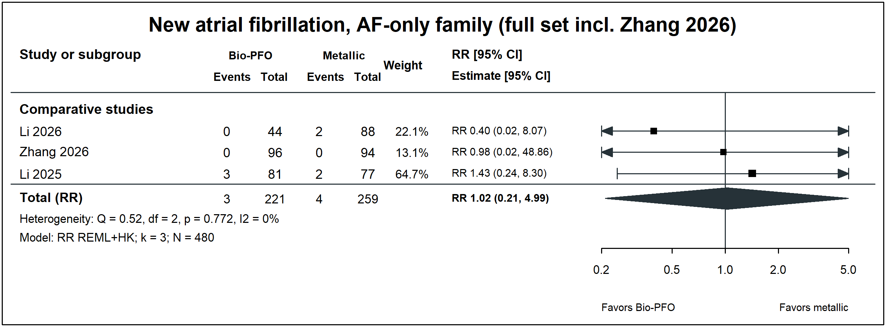
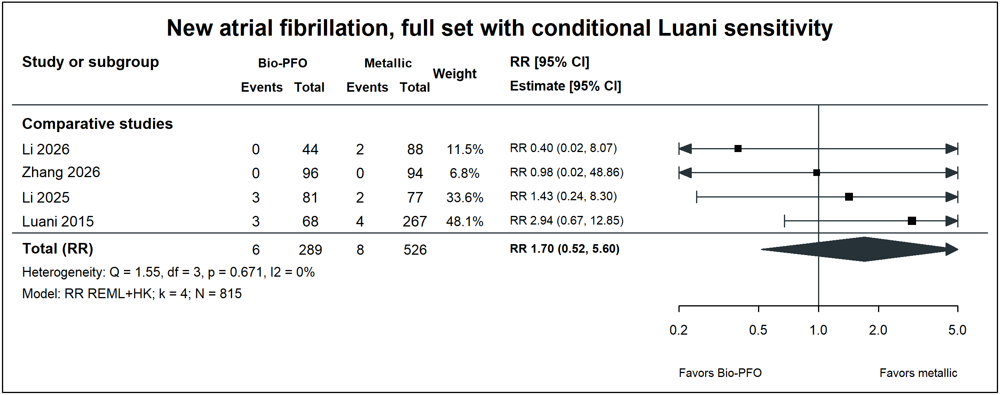
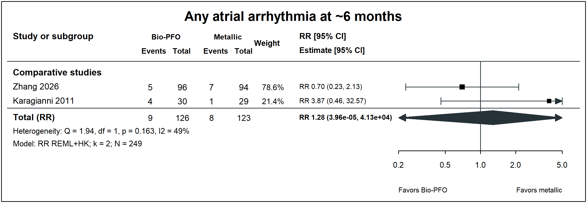
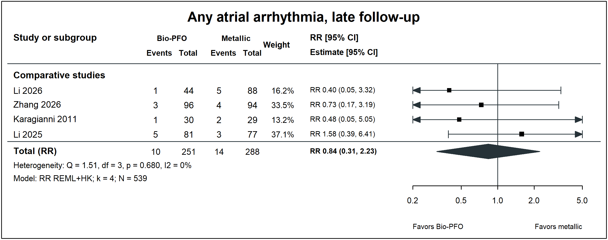
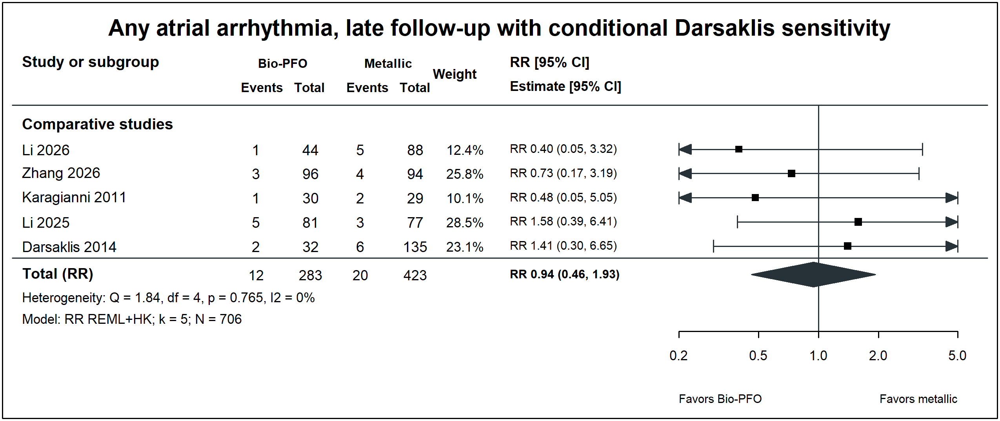
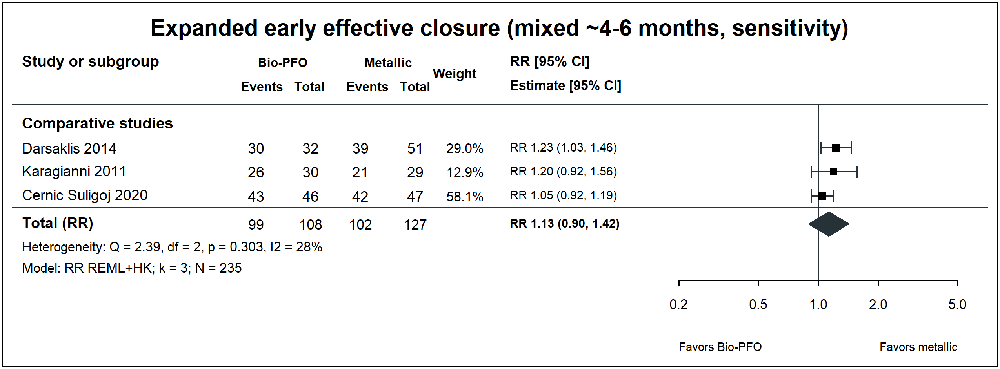
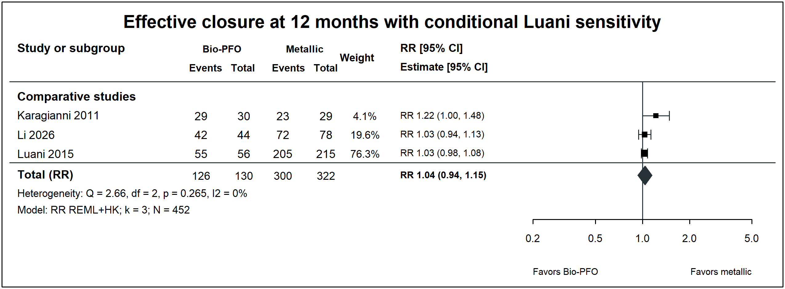
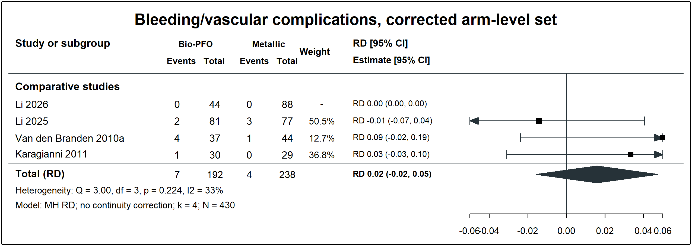
